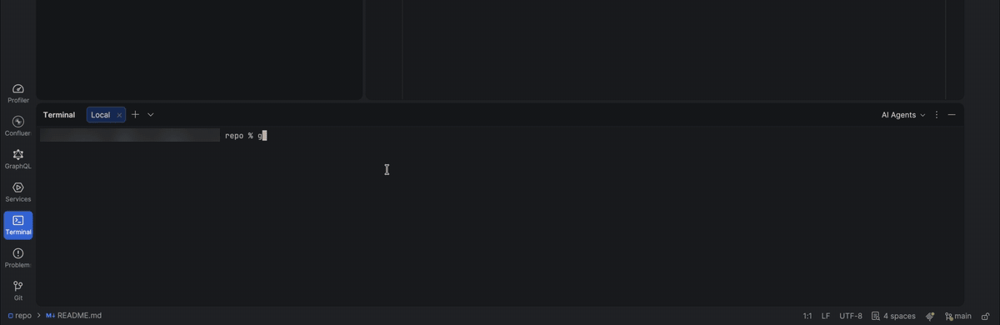

<div align="center">

# Gitceps

**A gym bro who lifts your code every time you `git push`**

A small macOS app and git hooks. He pops up in the corner of your screen when you push, pull, rebase or clone, and blocks pushes that contain passwords or API keys.



</div>

## Install

macOS only. Requires Apple's Command Line Tools (`xcode-select --install`).

```sh
curl -fsSL https://raw.githubusercontent.com/ArturVah/gitceps/main/install.sh | bash
```

Or with Homebrew:

```sh
brew install ArturVah/tap/gitceps && gitceps on
```

Both build the app on your Mac and turn Gitceps on for every repo. Each repo's own hooks keep running. Repos that set their own hooks folder, such as those using Husky, skip him.

## Quickstart

Push from any repo, in the terminal or your editor:

```sh
git push
```

He appears in the bottom-right corner of the screen your mouse is on, for a few seconds. The push never waits for him.

## Reactions

| Push | Reaction |
|---|---|
| 1 to 10 lines | Lifts it, bored: "this? seriously?" |
| A normal push | "light weight, baby!" |
| 400+ lines | Sweats, shakes, gets it up, then falls over. |
| 10,000+ lines | Gives up and comes back driving a forklift. |
| A big push whose message says "small", "typo" or "quick" | Reads the message out loud, then the camera zooms in: "SMALL?!" |
| `git push --force` | Screams while the screen shakes. |
| A push git refuses because someone pushed first | The bar bounces off the cloud and lands on his foot. |
| A password or API key | Says "NOPE", throws your code away and stops the push. |
| `git pull` of 50+ lines | Tug of war with the cloud over your teammates' commits. Past 400 lines, the cloud wins and he gets yanked off his feet. |
| `git commit --amend` on a commit you already pushed | Tiptoes in, swaps a plate, whistles. "nobody saw that." |
| `git rebase` of 3+ commits | Juggles the plates and racks them in a new order. "history is whatever I say it is." |
| `git clone` | Walks into an empty gym. "new gym. who dis?" |

## Settings

```sh
gitceps list                   # each switch and whether it's on
gitceps disable rebase         # no animation on rebase, in every repo
gitceps disable all --here     # no animation in the repo you're in
gitceps disable secrets        # skip the secret check
gitceps off                    # turn Gitceps off completely
```

`enable` turns a switch back on, and `on` brings him back. `all` mutes the animation but keeps the secret check. Settings are stored in git config under `[gitceps]`, and `--here` writes to the current repo's `.git/config`. With the curl install, the command is `~/.gitceps/bin/gitceps`.

To uninstall, run `gitceps off` first, then `rm -rf ~/.gitceps` or `brew uninstall gitceps`. Skipping `off` leaves git looking for hooks in a folder that no longer exists, and your repos' own hooks stop running.

## Secret check

Before every push, the hook scans the new lines for GitHub, Stripe, AWS, Slack, Anthropic and OpenAI keys, private keys, and quoted values like `password = "..."`. It also flags added `.env` files (templates such as `.env.example` are fine), `id_rsa`, `id_ed25519`, `credentials.json` and `*.pem`. On a match, the push stops.

If the match is a fake test value, push anyway with `git push --no-verify`. The check catches common mistakes; use a dedicated scanner such as [gitleaks](https://github.com/gitleaks/gitleaks) for full coverage.

## Notes

- There's no sound yet. He grunts in text only.
- Homebrew won't build from source while an installed Xcode is older than your macOS. Update Xcode, or use the curl installer.
- To watch every reaction without installing anything, clone the repo and open `preview.html`.
- With Gitceps on, a repo's own `push-to-checkout` and `proc-receive` hooks don't run. Only repos that receive pushes and run custom code on them use those.
- The hooks add about 10 ms to a commit or branch switch, and about 90 ms to a push because of the secret scan. The app uses about 60 MB while he's on screen and quits when he leaves.
- Logs go to `~/Library/Logs/gitceps.log`.

## License

MIT
