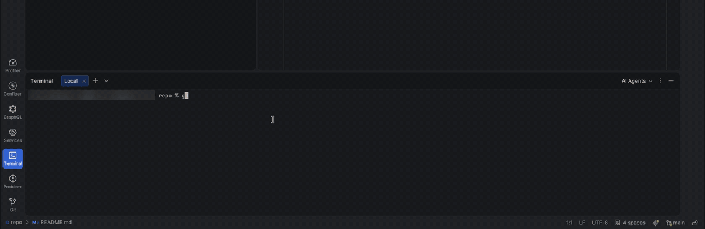

<div align="center">

# Gitceps

**A gym bro who pushes your code to the cloud every time you `git push`**

A small app and git hooks for macOS, Linux and Windows. He pops up in the corner of your screen when you push, pull, rebase or clone, and blocks pushes that contain passwords or API keys. With Claude Code or Codex, he also walks you through pull requests and commits.



</div>

## Install

macOS and Linux:

```sh
curl -fsSL https://raw.githubusercontent.com/ArturVah/gitceps/main/install.sh | bash
```

Windows, in PowerShell:

```powershell
irm https://raw.githubusercontent.com/ArturVah/gitceps/main/install.ps1 | iex
```

Or with Homebrew:

```sh
brew install ArturVah/tap/gitceps && gitceps on
```

All of them turn Gitceps on for every repo, by pointing git's global `core.hooksPath` at the `.gitceps/hooks` folder in your home folder. That's the only git setting he changes. Each repo's own hooks keep running. Repos that set their own hooks folder, such as those using Husky, skip him.

The installers check each download against the checksums published with the release. Every release file also carries a build attestation, which `gh attestation verify <file> --repo ArturVah/gitceps` checks.

Linux and Windows are in beta:

- **Linux** needs the WebKitGTK 4.1 library for his windows (`libwebkit2gtk-4.1-0` on Debian and Ubuntu, `webkit2gtk4.1` on Fedora), and X11 or XWayland to place them. On Wayland alone the push reactions are skipped and a tour opens without Push Bro. Without the library the secret check still runs.
- **Windows** needs [Git for Windows](https://gitforwindows.org) and WebView2, which Windows 11 and an up-to-date Windows 10 already have. He doesn't appear above a game or video in exclusive full screen.

## Quickstart

Push from any repo, in the terminal or your editor:

```sh
git push
```

He appears in the bottom-right corner of the screen your mouse is on, for a few seconds. The push never waits for him.

## Reactions

| Push | Reaction |
|---|---|
| 1 to 10 lines | Pushes it up with one hand, bored: "this? seriously?" |
| A normal push | "light weight, baby!" |
| 400+ lines | Sweats, shakes, gets it up, then falls over. |
| 10,000+ lines | Gives up and comes back driving a forklift. |
| A big push whose message says "small", "typo" or "quick" | Reads the message out loud, then the camera zooms in: "SMALL?!" |
| `git push --force` | Screams while the screen shakes. |
| A push git refuses because someone pushed first | The bar bounces off the cloud and lands on his foot. |
| A password or API key | Says "NOPE", throws your code away and stops the push. |
| `git pull` of 50+ lines | Tug of war with the cloud over your teammates' commits. Past 400 lines, the cloud wins and he gets yanked off his feet. |
| `git commit --amend` on a commit you already pushed | Tiptoes in, swaps a plate, whistles. "nobody saw that." |
| `git rebase` of 3+ commits | Juggles the plates and racks them in a new order. "history is whatever I say it is." |
| `git clone` | Walks into an empty gym. "new gym. who dis?" |

## Settings

```sh
gitceps list                   # each switch and whether it's on
gitceps disable rebase         # no animation on rebase, in every repo
gitceps disable all --here     # no animation in the repo you're in
gitceps disable secrets        # skip the secret check
gitceps off                    # turn Gitceps off completely
gitceps update                 # get the latest version
```

`enable` turns a switch back on, and `on` brings him back. `all` mutes the animation but keeps the secret check. Settings are stored in git config under `[gitceps]`, and `--here` writes to the current repo's `.git/config`. With the curl install on macOS and Linux, the command is `~/.gitceps/bin/gitceps`.

`gitceps update` keeps him on or off, as he was. If Homebrew installed him, update with `brew upgrade gitceps` instead, then run `gitceps on` once more.

To uninstall, run `gitceps off` first (it also removes the tour skill), then delete the `.gitceps` folder in your home folder, and run `brew uninstall gitceps` if that's how he came. Skipping `off` leaves git pointed at his hooks folder: your repos' own hooks keep running from there until the folder is deleted, and stop once it is.

## Secret check

Before every push, the hook scans the new lines for GitHub, Stripe, AWS, Slack, Anthropic and OpenAI keys, private keys, and quoted values like `password = "..."`. It also flags added `.env` files (templates such as `.env.example` are fine), `id_rsa`, `id_ed25519`, `credentials.json` and `*.pem`. On a match, the push stops.

If the match is a fake test value, push anyway with `git push --no-verify`. The check catches common mistakes; use a dedicated scanner such as [gitleaks](https://github.com/gitleaks/gitleaks) for full coverage.

## Tours of PRs and commits

If you use Claude Code or Codex, ask it:

```
tour PR #18
walk me through my last commit
```

Say "tour" or "walk me through" rather than "review": "review PR #18" starts your agent's own code review instead. In Claude Code, `/gitceps-tour PR 18` picks the tour by name.

Your agent reviews the change and writes a tour: a few steps in the order the code runs, the lines worth reading in each, and what they do. Gitceps checks that every changed line is either in a step or listed as skipped with a reason, then opens the tour in a panel that floats beside your editor, with the steps in a sidebar. Push Bro stands next to the panel and reacts to each step in his speech bubble: he nods along on plain code, cheers when a check refuses what it should, and zooms in for a "NOPE" on a real bug. Nothing moves until you click Got It, or press Return once the panel has focus. For a serious review, untick Push Bro to keep only the code and the explanations.

It works with GitHub, Bitbucket, or any repo you have cloned, and on a single commit or a range of them. Asking for the same PR or commit again reopens its tour without a new review, until it gets new commits. Gitceps itself uploads nothing: your agent reads your local clone as it does for any task, and the panel shows lines straight from git.

`gitceps on` adds the skill to Claude Code and Codex when they're installed, and `gitceps off` removes it. For a second profile, set with `CLAUDE_CONFIG_DIR` or `CODEX_HOME`, run `gitceps on` once with it set, and `gitceps off` the same way. After installing one of those apps, run `gitceps on` once more. A tour uses your agent's own subscription.

## Notes

- There's no sound yet. He grunts in text only.
- To watch every reaction without installing anything, clone the repo and open `preview.html`.
- With Gitceps on, four of a repo's own hooks don't run: `push-to-checkout` and `proc-receive`, which only repos that receive pushes use, and `reference-transaction` and `post-index-change`, which git calls too often to pass along.
- The hooks add about 30 ms to a commit and about 60 ms to a push, most of it the secret scan. His window uses about 70 MB while he's on screen and quits when he leaves.
- Logs go to `~/Library/Logs/gitceps.log` on a Mac, and to `gitceps.log` in the `.gitceps` folder elsewhere.

## Contributing

[CONTRIBUTING.md](CONTRIBUTING.md) shows how the pieces fit together, how to change a reaction or add one, and how to build and test. To report a security problem, see [SECURITY.md](.github/SECURITY.md).

## License

[MIT](LICENSE)
